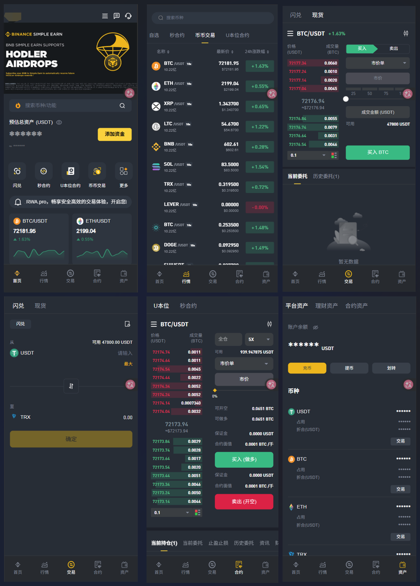
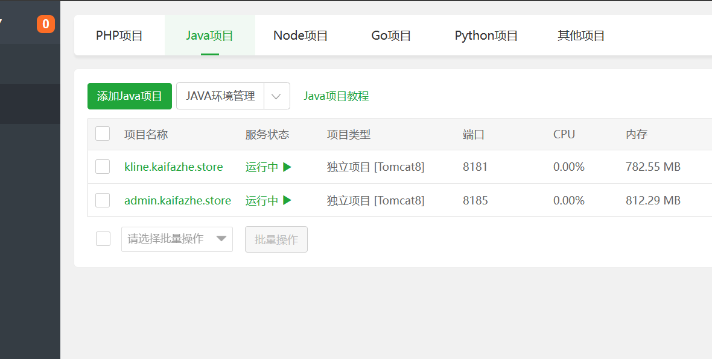
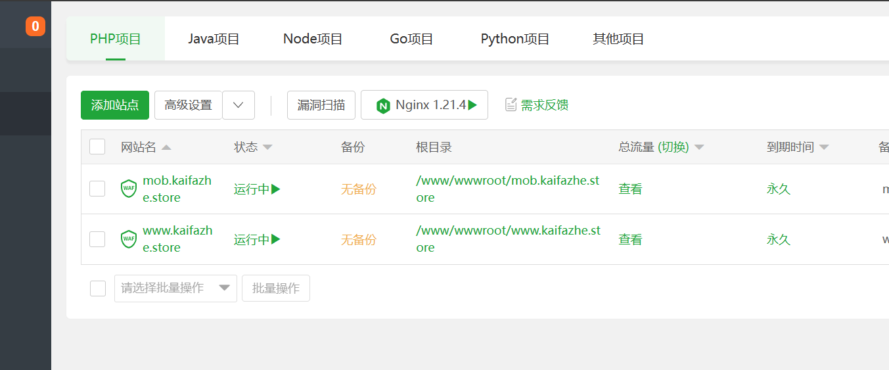

# 2026新版交易所模仿币安交易所APP



# 2026年4月份交易所重构大升级，升级日志

## 一、一期处理列表

- [ ] 登录与账户接管链路修复：钱包地址登录必须增加 challenge 签名校验，禁止“仅凭地址登录”。
- [ ] 对象级授权（IDOR/BOLA）加固：仓位、止盈止损、银行卡、后台审核/调账/KYC 等接口统一增加“资源归属校验 + 角色范围校验”。
- [ ] 后台高危越权封堵：充值/提现审核、调账、改密、拉黑、代理归属等操作增加强校验（团队边界、审批链、不可越权）。
- [ ] 2FA 密钥泄露处置：下线匿名可访问二维码/密钥接口，轮换历史密钥。
- [ ] 资金回调验签强制化：充值/提现回调增加签名校验、时间窗校验、nonce 防重放，失败即拒绝。

## 二、二期处理列表

- [ ] 资金状态机幂等化：充值、提现、退款、结算、划转全链路引入幂等键与状态 CAS，避免重复入账/退款/派奖。
- [ ] 事务一致性改造：内部划转、结算、审核资金动作改为单事务或可靠补偿事务，防止中间态失衡。
- [ ] 密码与凭据治理：移除默认弱口令（如 `123456`），改密接口强制绑定当前登录主体。
- [ ] 敏感日志脱敏：禁止打印 raw body、sign、证件号、手机号、地址、密钥，接入统一脱敏中间件。
- [ ] 前端高危操作防重：提现/下单/审核/保存做前后端双重防重复（按钮锁 + 服务端幂等）。
- [ ] URL 传敏整改：敏感参数（提现、2FA、验证码、密钥等）不得通过 URL 传递。

## 三、三期处理列表

- [ ] 密钥管理体系升级：移除配置/代码中的硬编码密钥，迁移至密钥管理服务。
- [ ] XSS 治理：公告/帮助中心/站内信等富文本入口启用内容净化、输出编码与 CSP。
- [ ] SSRF 与不安全 HTTP 工具治理：目标地址白名单、禁用 trust-all SSL、补齐证书与主机名校验。
- [ ] 依赖治理与 SBOM：升级高危依赖，移除高风险 `system-scope` 本地 jar，建立组件清单。
- [ ] 稳定性优化：邀请码 `while(true)` 改为有限重试 + 兜底方案，避免高并发性能衰减。
- [ ] 环境配置隔离：防止 dev 配置串用到生产，增加启动时环境校验。

## 四、四期处理列表

- [ ] Druid 监控台公网暴露与默认口令风险是否仍存在。
- [ ] 富文本存储型 XSS 是否可稳定触发。
- [ ] SSRF/LFI/MITM 工具链是否可形成实际可利用路径。
- [ ] 依赖漏洞在当前运行路径是否可达（需可达性验证）。


# 2024 区块链永续合约最新BicoGlobal交易所源码/仿币安火币/法币交易/理财期权/矿机认购/运营版本

```
//我的飞机号https://t.me/usdtvps666

如果飞机加不上我，可以先给我发个邮件。

//邮箱：ovouvogh@gmail.com

祝大家发财！
```

### 测试Demo

```
前端PC站：https://bipc.jiaoyisuo.shop
前端H5站：https://bih5.jiaoyisuo.shop
2026更新演示站地址
```


# 简介

```
提供腾讯云镜像文件、VMWARE 虚拟机本地java 开发环境和VUE开发环境。
```

数字火币区块链系统，BicoGlobal交易所源码/仿币安火币/法币交易/理财期权/矿机认购/运营版本。


# 架构

BicoGlobal数字货币区块链交易所系统, 需要技术支持以及完整商业版本，请联系我：https://t.me/usdtvps666

#### 自助下单：https://www.bnbcode.com

- JAVA Jvm C+ 开发
- WEB端采用 Vue3.js Mvc Element UI 开发
- 移动端采用主流开发语言开发 ，支持苹果，安卓，双端APP，支持 Uniapp H5 微信小程序 平板 全方位平台终端
- 安卓原生 Android Studio JAVA JVM C+.
- 原生苹果 IOS Xcode Objective-C.
- 原生开发 安卓，苹果，APP 采用 UNIAPP+uView UI.


# 模块介绍

1. 法币交易
2. 币币交易
3. 永续合约
4. 期权合约
5. 新币认购
6. 投资理财
7. 期货合约
8. 上币申请
9. 多级返佣
10. 无限代理
11. 邀请分销
12. 法币商家
13. 独立代理
14. 机器撮合
15. 代币功能
16. 客服系统
17. 白昼模式
18. 模板切换
19. 国际语言
20. 签到邀请
21. 云算矿机
22. 群聊社区

# 部署截图





# 编译说明Build Setup Vue


``` bash
# install dependencies，建议使用全局代理，否则会报错，即install 成功，但有缺失
npm install

# serve with hot reload at localhost:8080
npm run dev

# build for production with minification
npm run build

# build for production and view the bundle analyzer report
npm run build --report
```

